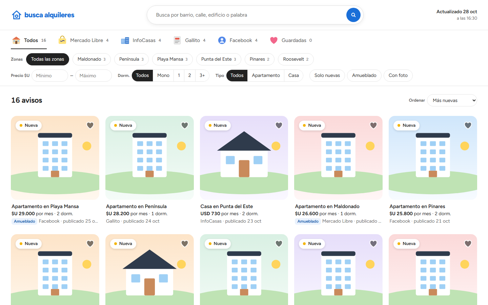

# busca-alquileres-uy

Skill de Claude que busca alquileres en Uruguay en Mercado Libre, InfoCasas, Gallito y Facebook Marketplace, los guarda en SQLite y publica un buscador con filtros como artefacto con link fijo.

**Requisitos:** app de escritorio de Claude, Chrome con la extensión Claude in Chrome y Node.js 22.13 o más nuevo.

**Instalación:** copia esta carpeta en `~/.claude/skills/`.

**Uso:** escribe `/busca-alquileres-uy` en Claude, responde el quiz y ten iniciada la sesión de Facebook y Mercado Libre en tu Chrome.

**Aviso:** algunos sitios no permiten la navegación automática en sus condiciones de uso. Úsalo bajo tu responsabilidad.
